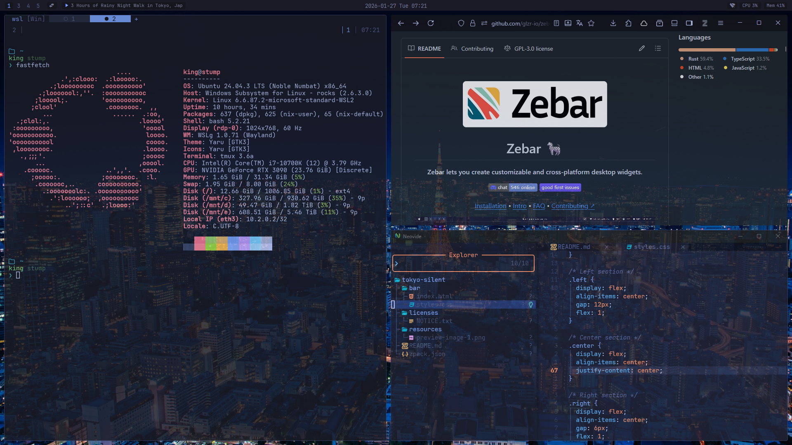

# ryha

The hypr-win Zebar bar, based on [Tokyo Silence](https://github.com/y4m3/zebar-tokyo-silence) by y4m3.



## Features

- Thin, low-contrast bar designed to stay out of the way.
- GlazeWM workspaces and tiling direction indicator.
- Media title marquee with hover-only scroll and pause-aware behavior.
- CPU/Mem/Battery/Network indicators.

## Requirements

- Zebar 3.2.0 or later

## Install

`copy_to_user_folder.bat` copies it to `~\.glzr\zebar\ryha`, and `../settings.json` starts it:

```json
{
  "startupConfigs": [
    {
      "pack": "ryha",
      "widget": "bar",
      "preset": "default"
    }
  ]
}
```

## Customization

- Bar height: `--bar-item-height` in `bar/styles.css`
- Marquee speed/gap: `--marquee-speed` / `--marquee-gap` in `bar/styles.css`
- Colors: `:root` variables in `bar/styles.css`

## License

MIT. See `LICENSE`.

Fonts are loaded via CDN; no font files are redistributed. See `licenses/NOTICE.txt`.
