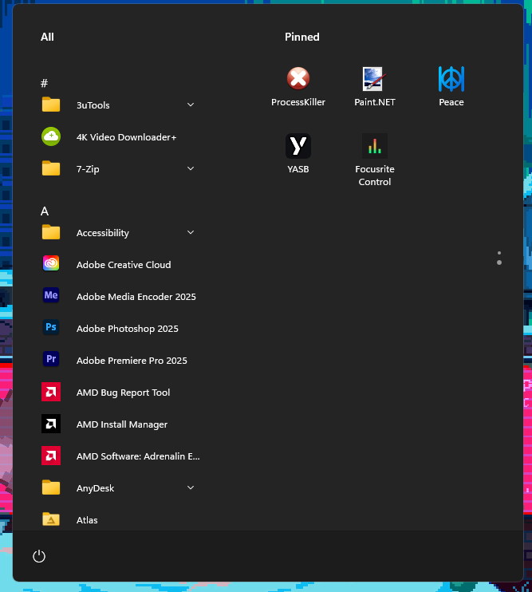
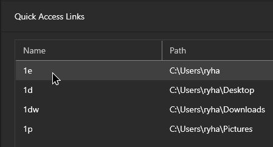

# hypr-win

My [Omarchy](https://omarchy.org)-style tiling setup on Windows, the Windows sibling of
[hypr-mac](https://github.com/RyanAHayden/hypr-mac): the same keys, workspaces and shell.

- **Tiling** with [GlazeWM](https://github.com/glzr-io/glazewm). SUPER is the Win key (physical left Alt on the remapped PowerToys layout), and the binds follow Omarchy's
- **Workspaces** 1-10 plus a scratchpad (S), which is the laptop screen's workspace when docked
- **Workspace bar** drawn by Zebar
- **Unix-style shell**: PowerShell 7 in Windows Terminal with fzf, zoxide, eza, starship and zsh-like history search
- **Two steps**: `installs.bat` installs everything, `setup-windows.ps1` applies the Windows settings

!! GlazeWM Zebar themes are not changed by `CHANGE_COLORS.md` yet.

# Setup
Install what you want manually or run the included `installs.bat`, which installs the apps and tools below. Then run `powershell -NoProfile -ExecutionPolicy Bypass -File setup-windows.ps1` to apply the Windows settings this config expects (safe to re-run):
- Narrator, its Ctrl+Win+Enter shortcut and blue focus box off; Sticky/Filter/Toggle Keys shortcuts off
- Snap, window arrangement and animations off (GlazeWM tiles instead)
- Taskbar auto-hidden and left-aligned, no search box or Task View; dark mode, no transparency
- File extensions and hidden files shown
- Developer Mode on for Dotter symlinks (asks for administrator permission)
- PowerShell 7 (Microsoft Store build) as the Windows OpenSSH shell; a SYSTEM task follows Store updates at boot and hourly, preserving the no-window launcher when installed. SSH stays managed by `sshd-user`; setup does not enable the `sshd` service
- PSFzf installed; Windows Terminal set as the default terminal app with PowerShell 7 as its default profile
- Python `websockets` installed for the GlazeWM focus lock
- `hyprwin.exe` built from `.glzr/glazewm/hyprwin.cs` into `~\.glzr\glazewm` with the C# compiler built into Windows. GlazeWM starts it as the SUPER+Tab switcher and the dwindle tiler. The switcher also moves Start to SUPER+Alt, handles SUPER+C/V, and runs the helper binds (Alt+Tab cycle, SUPER+S/F/Q/\\ and friends, Zebar and focus-lock toggles) on an open GlazeWM connection, so they don't start a process per press. Those binds, SUPER+Space/Ctrl+V/Ctrl+E (Vicinae) and SUPER+Escape (system menu) are only in the switcher: GlazeWM copies would fire as well whenever GlazeWM's keyboard hook runs first (re-run `setup-windows.ps1` after editing it)
- An elevated, hidden-at-logon scheduled task keeps `sshd.exe` windows and their descendants hidden (asks for administrator permission)
- Greenshot started at logon and set to region-capture to the clipboard on F22, which hyprwin sends for SUPER+Shift+S (Windows reserves Win+Shift+S for Snipping Tool)
- An elevated logon task (`PowerToys/Keyboard Manager/ctrl_caps_lock.py`) makes physical Ctrl+Caps Lock toggle Caps Lock, even while Caps Lock is remapped to Ctrl
- GlazeWM, AltSnap and PowerToys start from logon tasks instead of the Run key (PowerToys and AltSnap run elevated for remapping and dragging admin windows), and Flow Launcher's logon task loses its delay. GlazeWM waits 10 seconds for the desktop to settle and retries failures up to three times at one-minute intervals; GlazeWM, AltSnap, hyprwin and the Keyboard Manager engine run at high CPU priority, Zebar and Flow Launcher above normal; and the hyprwin switcher runs elevated (through a task) so SUPER binds work, and SUPER alone doesn't open Start, over admin windows (asks for administrator permission)
- A virtual display (`install-virtual-display.ps1`, cloned with the built-in screen) so Sunshine/Moonlight still works with the lid closed; set the lid to "Do nothing" with Flow Launcher's **Toggle Lid Sleep**
Sign out and back in afterwards for every setting to apply.

# Keys (SUPER = Win)
GlazeWM's `win` is SUPER. With the PowerToys remapped laptop layout (`PowerToys/Keyboard Manager`), physical left Alt is Win (SUPER), Win is Alt, Caps Lock is Ctrl and Ctrl+H/J/K/L are arrows, so the bottom row reads Ctrl / Alt / SUPER like hypr-mac. Full list: `.glzr/glazewm/config.yaml` (SUPER+I searches it).

| Key | Action |
|---|---|
| SUPER+I | Key hints: search every keybind (fzf) |
| SUPER+Alt (tap together) | Start menu (SUPER alone no longer opens it) |
| SUPER+C / SUPER+V | Copy / paste everywhere, terminals included (sent as Ctrl+Insert / Shift+Insert) |
| SUPER+Space | Vicinae launcher (again closes it) |
| SUPER+Ctrl+V / SUPER+Ctrl+E | Vicinae clipboard history / emoji picker |
| Ctrl+Caps Lock | Toggle Caps Lock (turns it off if it gets stuck on) |
| SUPER+Enter | Terminal (Windows Terminal, PowerShell 7) |
| SUPER+H/J/K/L or arrows | Focus left / down / up / right |
| SUPER+Shift+H/J/K/L or arrows | Move window |
| SUPER+Tab | Window switcher, all windows. Keep holding SUPER: Tab next, Shift (tap) or Shift+Tab back, H/J/K/L move, Q closes the highlighted window; release SUPER to pick |
| Alt+Tab (+Shift) | Cycle focus through the windows on this workspace (PowerToys sends F13/F14 to GlazeWM) |
| SUPER+1..0 | Go to workspace (again goes back) |
| SUPER+Shift+1..0 | Move window to workspace and follow |
| SUPER+A / D | Previous / next workspace (with Shift: take the window) |
| SUPER+S | Toggle scratchpad (workspace S) |
| SUPER+Alt+S | Send window to the scratchpad and stay; on it, send the window back |
| SUPER+Shift+S | Greenshot region capture to the clipboard (hyprwin sends F22, Greenshot's `RegionHotkey`) |
| SUPER+M / SUPER+Alt+M | Minimize / bring back a minimized window (this workspace's first) |
| SUPER+F / SUPER+Alt+F | Maximize (bar stays visible) / fullscreen |
| SUPER+T | Float |
| SUPER+W / SUPER+Shift+W | Close window / force kill its app |
| SUPER+Q | Quit the app (closes all its windows; it can still ask to save) |
| SUPER+\ | Flip the split between the focused window and its neighbour (Hyprland's togglesplit) |
| SUPER+- / = | Shrink / grow the window's width (with Shift: height) |
| SUPER+/ , SUPER+Alt+/ | Display scaling of the focused window's monitor: bigger / more space, a step at a time (100%, 125%, 150%...) |
| SUPER+Shift+Space | Toggle the Zebar bar |
| SUPER+Shift+O | Toggle focus lock |
| SUPER+Shift+P | Pause all GlazeWM binds |
| SUPER+Escape | System menu (centered): lock, sleep, hibernate, keep awake with lid closed, reopen apps at login, relaunch GlazeWM, log out, restart, shut down. Also in Vicinae as "Power: ..." |
| SUPER+Shift+Enter / B / N / M / F / | Firefox / Edge / VS Code / Spotify / File Explorer / KeePassXC |
| Alt+Shift+R / W / E | Reload config / redraw / quit GlazeWM |

Unlike Hyprland, GlazeWM has no hidden special workspace, so the scratchpad is the real workspace S.

Tiling is Hyprland-style dwindle: `hyprwin dwindle` (started by GlazeWM) makes each new window split the focused one along its longer side.

# Linking configs with Dotter (Stow-style)
[Dotter](https://github.com/SuperCuber/dotter) links selected repo files into their application config locations, so edits in either location update the same file.

1. Install Dotter with `winget install SuperCuber.Dotter`.
2. Enable Developer Mode (Settings > System > For developers) to allow symbolic links.
3. Back up any existing config files that Dotter will manage; the first deployment may replace them.
4. Choose packages in `.dotter/local.toml` (machine-local and not tracked). Package names and their file mappings are listed in `.dotter/global.toml`. For example:
   ```toml
   packages = ["glazewm", "flowlauncher", "powertoys", "altsnap", "powershell"]
   ```
   Add or remove package names to choose which configs to manage. Zebar isn't a Dotter package because it won't load symlinked widget files; `copy_to_user_folder.bat` deploys it.
5. From the repo root, preview the changes with `dotter deploy --dry-run`. Deploy with `dotter deploy --force` the first time, then use `dotter deploy` for later updates.

Run `dotter undeploy` to remove the links. If an app replaces a managed file instead of editing it, the link is broken; run `dotter deploy` again to restore it.

# Install

## < [Nerd Font](https://github.com/ryanoasis/nerd-fonts/releases/latest/download/JetBrainsMono.zip) > (Required for icons)
```
winget install --id DEVCOM.JetBrainsMonoNerdFont
```
## < [GlazeWM](https://github.com/glzr-io/glazewm) >
```
winget install -e --id glzr-io.glazewm
```

## < [AltSnap](https://github.com/RamonUnch/AltSnap) >
```
winget install AltSnap.AltSnap
```

### Config:
The included `AltSnap.ini` is deployed by `setup-elevated-windows.ps1`, which copies AltSnap into `Program Files\hypr-win\AltSnap` with the ini beside it and runs it elevated so it can drag admin windows (re-run it after editing the ini or updating AltSnap). It drags with SUPER or Alt (on the laptop layout, physical Alt is SUPER), keeps Aero/side snapping, right-click combos (SideSnap, edge extend, scroll zoom) and resize-all, and ignores Zebar.

## < [Vicinae](https://vicinae.com) >
```
winget install Vicinae.Vicinae
```

### Config:
Vicinae stands in for hypr-mac's Raycast, and everything about it comes from files, so setup applies it all. `Vicinae/hypr-win.jsonc` (compact window, no favorites, back to root search on close, no tray icon) is imported by Vicinae's `settings.json`, which `setup-windows.ps1` points at it; settings changed in Vicinae's own window go to `settings.json` and win over it. The `Power: ...` Script Commands in `Vicinae/scripts` are hypr-mac's Raycast ones, ported (Vicinae reads `@raycast` directives); the `vicinae` Dotter package links them into Vicinae's script folder, and SUPER+Escape runs the same scripts from a native menu (`hyprwin powermenu`). hyprwin runs Vicinae's [deeplinks](https://docs.vicinae.com/deeplinks) for SUPER+Space, SUPER+Ctrl+V and SUPER+Ctrl+E like hypr-mac's binds: Windows keeps Win+Space for itself, so no launcher can register SUPER+Space directly. Setup starts Vicinae at logon and disables Flow Launcher's logon task, which would take Alt+Space.

## < [WindHawk](https://windhawk.net/) >
```
winget install windhawk
```

### Mods
listed in /Windhawk/userprofile.json
- `windows-11-start-menu-styler` (SideBySideMinimal)
- `taskbar-icon-size` - Height: `28` - Icon: `20` - Width: `28`
- `windows-11-taskbar-styler` - SimplyTransparent
  


## < [Flow Launcher](https://github.com/Flow-Launcher/Flow.Launcher) >
```
winget install "Flow Launcher"
```
### Settings & Theme
Copy `/FlowLauncher` to
`C:\Users\{user}\AppData\Roaming`
Apply `ryha` using `fltheme ryha`

### Plugins
- Steam Search `by Garulf`
- Visual Studio Code Workspaces `by ricardosantos9521, MaskedRPGFan`
- FlowYoutube `by Garulf`

### Plugin Settings
Set explorer shortcuts like these:



# Recommended
## Keyboard bindings in administrator windows
PowerToys must run as administrator for Keyboard Manager remaps to work in elevated terminals. This config enables **Always run as administrator** and elevated-app warnings. After deploying, use PowerToys Settings > General > **Restart as administrator** once; changing the config does not elevate an already-running process.

The keyboard-layout toggle and GlazeWM startup reload request administrator permission before restarting the remapper, preserving support for admin windows. Accept the UAC prompt; cancelling leaves the current engine/layout unchanged. Only PowerToys and the remapper restart script need elevation, not your normal terminals or other apps.

## < [Zen Browser](https://zen-browser.app/) >
### Settings
- Compact Hides Sidebar and Top Toolbar

## < [TwinkleTray](https://twinkletray.com/) >
```
winget install xanderfrangos.twinkletray
```

# Shell
`PowerShell/Microsoft.PowerShell_profile.ps1` gives PowerShell 7 the same Unix-style shell as [hypr-mac](https://github.com/RyanAHayden/hypr-mac)'s `.zshrc`. It is the `powershell` Dotter package, along with the shared `starship.toml`. Dotter deploys `PowerShell/profile_loader.ps1` as a plain file that dot-sources it, because Windows OpenSSH sessions refuse to follow user-created symlinks (the profile reads winget link targets directly over SSH for the same reason). `installs.bat` installs the tools it uses (fzf, PSFzf, zoxide, eza, bat, fd, starship, Neovim).

## SSH without flashing console windows

`OpenSSH\ssh-no-window` contains the launcher source, manifest, build script and passwordless SSH checks. It requires Windows 11 24H2 (build 26100) or later and MinGW-w64's `gcc` and `windres` on PATH. It prevents console creation for command SSH while preserving interactive terminals.

With passwordless localhost SSH already working through the enabled `sshd-user` task and the `sshd` service stopped and disabled, run this from an elevated PowerShell window:

```powershell
.\OpenSSH\ssh-no-window\install.ps1
```

The installer builds from source, deploys to `%ProgramFiles%\hypr-win\ssh-no-window`, updates the shell-sync script, restarts only the task's listener and checks public-key command and interactive logins with password authentication disabled. Failed checks restore the previous setup. Use `-UserName` if the SSH login differs from the current Windows username.

Only source is tracked: binaries, `launcher.ini`, shell-path backups and logs are generated locally, outside Git. No keys, passwords, usernames or machine-specific paths are included in the launcher source. Re-run `.\OpenSSH\ssh-no-window\verify.ps1` to check the installed setup.

| Key / command | Action |
|---|---|
| Up / Down | history matching what's typed so far (`ssh`↑ → `ssh rycs`) |
| Tab | completion menu |
| Ctrl+R / Ctrl+T / Alt+C | fzf history / insert file / cd into dir |
| Ctrl+A/E/W/U/K/Y, Alt+B/F | Emacs line editing, like bash/zsh |
| Ctrl+X Ctrl+E | edit the command line in nvim |
| `cd x` | normal cd, falls back to zoxide (most used dir matching `x`); `z`, `zi` work too |
| `ls` `lsa` `lt` `lta` | eza long / all / tree / tree all |
| `ff` `eff` `sff host:dir` | fzf with bat preview / open pick in nvim / scp pick |
| `..` `...` `....` | up 1/2/3 directories |
| `n` | nvim (current dir if no args) |
| `g` `gcm` `gcam` `gcad` | git / commit -m / commit -a -m / commit -a --amend |
| `ga branch` / `gd` | new branch in worktree `../<repo>--<branch>` / remove it from inside |
| `compress dir` / `decompress file` | tar.gz |
| `stay cmd...` | run detached |

`gcm` replaces PowerShell's `Get-Command` alias; type `Get-Command` in full. Put machine-local additions in `profile.local.ps1` next to the profile; it isn't tracked.

---